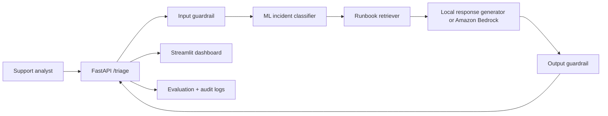

# AI Incident-Triage & Root-Cause Copilot

A portfolio-ready ML/GenAI system that classifies IT incidents, retrieves relevant troubleshooting runbooks, produces a cited root-cause recommendation, applies safety checks, and evaluates the system end to end.

## Why this project exists

Operations teams often lose time manually categorizing tickets, searching old incidents, and verifying whether an AI-generated fix is grounded in approved documentation. This project turns that workflow into an observable, testable application.

## System architecture



## MVP capabilities

- Classifies incidents into `network`, `av`, `authentication`, `software`, or `hardware`
- Predicts severity and confidence
- Retrieves the most relevant approved runbook passages
- Generates a concise diagnosis with source citations
- Detects prompt-injection patterns and masks common PII locally
- Provides optional Amazon Bedrock Knowledge Bases and Guardrails adapters
- Evaluates classification accuracy, retrieval hit rate, citation coverage, safety blocking, and latency
- Exposes a FastAPI service and Streamlit analyst dashboard
- Includes tests, Docker configuration, and GitHub Actions CI

## Quick start

```bash
python -m venv .venv
source .venv/bin/activate          # Windows: .venv\\Scripts\\activate
pip install -r requirements.txt

python scripts/bootstrap.py
uvicorn app.api:app --reload
```

Open `http://127.0.0.1:8000/docs` for the interactive API documentation.

In another terminal:

```bash
streamlit run app/dashboard.py
```

## Try the API

```bash
curl -X POST http://127.0.0.1:8000/triage \
  -H 'Content-Type: application/json' \
  -d '{
    "title": "Lecture hall cannot connect to Wi-Fi",
    "description": "Instructor laptop repeatedly disconnects and receives a 169.254 address. Other rooms are working."
  }'
```

## Run evaluation

```bash
python -m src.evaluation.evaluate
```

Outputs are written to `artifacts/evaluation_report.json` and `artifacts/evaluation_cases.csv`.

## AWS mode

The local mode is the default. To use AWS, copy `.env.example` to `.env`, set `AI_PROVIDER=bedrock`, and provide the required identifiers.

The AWS adapter deliberately separates retrieval from generation:

1. Retrieve approved source chunks from an Amazon Bedrock Knowledge Base.
2. Apply a Bedrock Guardrail to user input.
3. Generate a response through the Bedrock Converse API.
4. Apply the guardrail again to model output.

This design keeps retrieval evidence visible and makes each stage independently testable.

## Repository structure

```text
app/                 FastAPI API and Streamlit interface
artifacts/           Generated model and evaluation outputs
data/                 Synthetic incidents and approved runbooks
scripts/              Bootstrap utilities
src/classification/   Training and inference
src/evaluation/       End-to-end quality checks
src/generation/       Local and Bedrock response generation
src/guardrails/       Input/output safeguards
src/retrieval/        Local and Bedrock retrieval
src/service/          Triage orchestration
src/storage/          Audit logging
tests/                Unit and API tests
```

## Evaluation gates

The first release uses these portfolio-friendly gates:

| Metric | Initial gate |
|---|---:|
| Classification accuracy | ≥ 0.85 |
| Retrieval hit rate@3 | ≥ 0.80 |
| Citation coverage | ≥ 0.95 |
| Unsafe prompt block rate | ≥ 0.90 |
| Local p95 latency | < 1.0 second |


## Responsible-use notes

- The system recommends troubleshooting steps; it does not execute infrastructure changes.
- Low-confidence cases are routed to human review.
- Synthetic data is included to avoid exposing real support records.
- Retrieved passages are treated as evidence, not automatically trusted instructions.
- PII masking in local mode is illustrative and should not replace enterprise data-loss-prevention controls.
